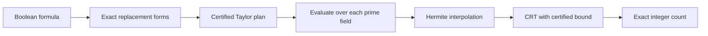

# Exact Counting Lab

**Exact #SAT / model-counting experiments in Python, with reproducible benchmarks and explicit limits.**

[](https://github.com/Bender1011001/exact-counting-lab/actions/workflows/verify.yml)
[](https://github.com/Bender1011001/exact-counting-lab/releases)
[](LICENSE)
[](#quick-start)

An independent research laboratory for the rational-interpolation route in the
OpenAI preprint *The Exponential Time Hypothesis is False*. It extends
[Chelsea A. McElveen's community implementation](https://github.com/chelsinchaos/measurement-indexed-counting)
with interchangeable exact components, independent checks, and comparisons with
brute force, variable elimination, and binary decision diagrams (BDDs).

**Status: experimental.** Component improvements are measured on small synthetic
instances. Established counting methods remain faster on the latest cases.
General solver superiority, mathematical novelty, and a new asymptotic bound
have not been established.

[Quick start](#quick-start) · [Results](#measured-results) · [How it works](#how-it-works) · [Contribute](CONTRIBUTING.md) · [Releases](https://github.com/Bender1011001/exact-counting-lab/releases)

## Quick start

Python 3.10 or newer; the core uses only the standard library. CI tests Python
3.11 and 3.12 on Windows and Linux.

```sh
git clone https://github.com/Bender1011001/exact-counting-lab.git
cd exact-counting-lab
python example.py
python verify.py
```

The worked example prints:

```text
Six-variable synthetic formula, seed 1
Polynomial pipeline: 32
Brute force: 32
Ordinary elimination: 32
CRT primes used: 1
Agreement checks passed. Use the benchmark runners for timings.
```

The complete suite passes **6,430 checks**, including exhaustive coefficient
comparisons, complete counts, resource/error controls, and interpolation tests.
Use normal Python execution; verification requires assertions enabled.

For benchmarks with the optional established BDD baseline, install the pinned
requirement in a virtual environment:

```sh
python -m pip install -r requirements-baseline.txt
python field_benchmarks.py --repeats 3 --output local-results/field.json
```

## What you can explore

| Component | What it does | Read more |
|---|---|---|
| Input-specific auxiliary construction | Queries only the operator entries needed by the input | [Derivation and controlled comparisons](IMPLICIT_DESIGN.md) |
| Cardinality-weighted reconstruction | Regroups repeated restricted sums and prunes cancelling terms | [Exact identity](DERIVATION.md) |
| Finite-field measurement fibers | Computes foreign measurement bases and labels modulo the current prime | [Field fibers](FIELD_FIBERS.md) |
| Certified Taylor planning | Uses actual occurrence degrees to request sufficient interpolation data | [Degree certificate](FIELD_FIBERS.md#request-only-certified-necessary-interpolation-data) |
| Exact modular recovery | Reconstructs the integer count once the CRT modulus exceeds a certified bound | [Implementation](modular_lab.py) |
| Reusable contraction plans | Evaluates integer or truncated-polynomial factors by variable elimination | [Contraction experiments](CONTRACTION.md) |

## Measured results

The auxiliary constructor gave **1.54-10.68x** complete-pipeline improvements on
three small cases against an eager constructor with its expensive global
membership audit disabled. One case took 8.51 ms here, versus 0.089 ms for brute
force and 0.489 ms for BDD. See [the October 30 controlled experiment](IMPLICIT_DESIGN.md).

The November 1 follow-up combines field preparation with certified Taylor
planning. Each row below is a complete count, median of three fresh-process
runs, including construction and recovery. Both columns use the same forms
and cofactor backend; only the representation/planning options change.

| Eight-variable case | Prior pipeline | Field + degree plan | Prior / new |
|---|---:|---:|---:|
| Reference schedule, seed 71 | 1,355.43 ms | 877.51 ms | 1.54x |
| Reference schedule, seed 72 | 247.07 ms | 971.68 ms | **0.25x** |
| Reference schedule, seed 73 | 236.94 ms | 659.92 ms | **0.36x** |
| Balanced schedule, seed 71 | 215.57 ms | 32.58 ms | 6.62x |
| Balanced schedule, seed 72 | 327.93 ms | 40.61 ms | 8.08x |
| Balanced schedule, seed 73 | 344.95 ms | 133.66 ms | 2.58x |

**Ratios below one are slower.** Lower Taylor orders can disable a useful
pruning shortcut, which explains the two losses. The balanced cases have
very low-degree deformations, including one constant deformation. Ordinary
elimination takes roughly 0.5-0.8 ms on these same inputs; brute force and BDD
also win. The new options remain opt-in.

Small-prime experiments were slower overall, and the measured inputs showed no
new measurement collisions. Keep these negative results in view when choosing
an experiment. [Full ablations, proof, raw data, and limitations](FIELD_FIBERS.md)
explain what each gain can and cannot establish.

Earlier measurements, memory observations, and cofactor experiments are retained
in [the benchmark history](BENCHMARK_HISTORY.md). Structured experiments through
64 variables are in [CONTRACTION.md](CONTRACTION.md).

## How it works



The degree bound limits how much Taylor data is needed. At each prime, finite-field
measurements can group equivalent labels while retaining every assignment and
its multiplicity. CRT combines the residues until the integer answer is unique
within the certified range.

Try the new options on a design from `example.py`:

```python
count, certificate = modular_lab.exact_modular_count(
    design, cnf.n, order,
    reconstruction=lab.cofactor_reconstruction,
    measurement_mode="field",  # default: "integer"
    use_form_degree=True,       # default: False
    use_disjoint_bound=True,
)
```

This is a research interface over the bundled design objects. A general-purpose
DIMACS command-line solver is not provided.

## Independent Wolfram check

The optional Mathematica audit expands complete symbolic counting polynomials
from the exported rational inputs and checks their Taylor coefficients against
Python. Mathematica 15.0.1 agreed on **63 coefficients** across three synthetic
designs. A local Wolfram license is needed only for this additional audit.

```sh
python export_field_wolfram.py
wolframscript -file verify-field-fibers.wl
```

[Audit script](verify-field-fibers.wl) · [Exact inputs](field-wolfram-input.json) · [Recorded result](field-wolfram-results.json)

## Scope and limitations

- This investigates the rational-interpolation route, not the sharper Appendix D algorithm.
- Cached assignments can use exponential space; the paper's polynomial-space bound does not apply to this implementation.
- The prime pool and construction limits are finite. The modular adapter is serial and not thread-safe.
- A large nominal auxiliary dimension is not a large solved Boolean instance.
- Small synthetic benchmarks do not establish a practical large-instance crossover.
- Full manuscript correctness and the Lean formalization have not been independently certified here.

## Attribution and license

The unmodified [reference module](third_party/measurement_toy.py) is Chelsea A.
McElveen's MIT-licensed executable exposition, pinned to commit
`7a73e39b11c71d2b3c7209074e04e84208612b58` of
[measurement-indexed-counting](https://github.com/chelsinchaos/measurement-indexed-counting).
Its [full license](third_party/LICENSE.txt) is retained. Reference SHA-256:
`e7a103af1d10f8442f98f79ee66eabf8190861473b45f5051f8d223008e4cb64`.

The mathematical source is the [OpenAI ETH preprint](https://github.com/openai/math/blob/main/preprints/The-Exponential-Time-Hypothesis-is-False-October-25-2026/paper.pdf),
examined at repository commit `4eaee87548250b2682affda7d05d947c05554bae`.
This project is independent of OpenAI and the reference author.
New code is [MIT licensed](LICENSE); upstream attribution remains intact.
All included fixtures are synthetic/public.

Questions, reproducible failures, and focused improvements are welcome through
[issues](https://github.com/Bender1011001/exact-counting-lab/issues) and pull requests.
See [CONTRIBUTING.md](CONTRIBUTING.md) for the measurement standards and next experiments.
